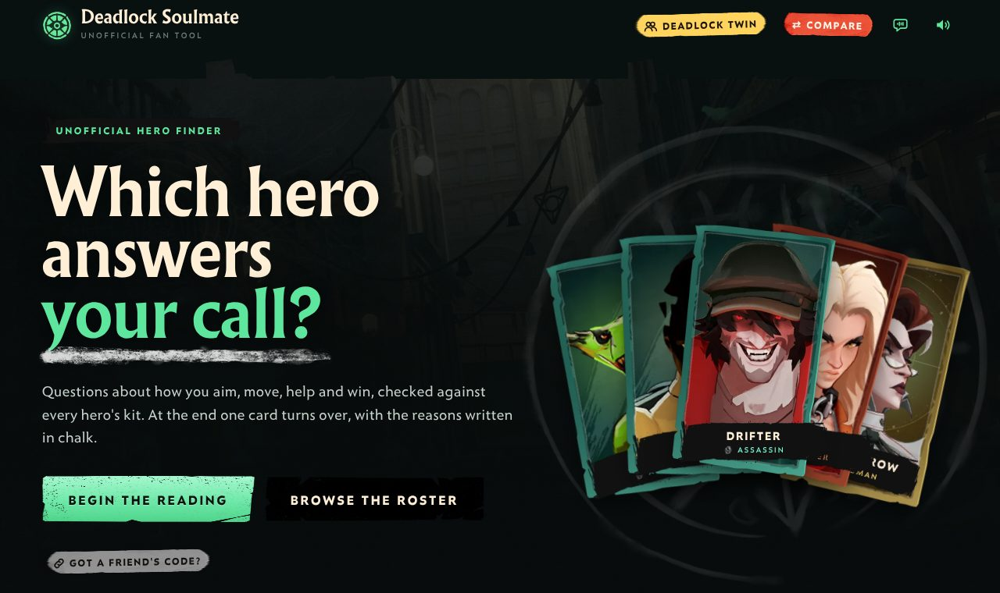
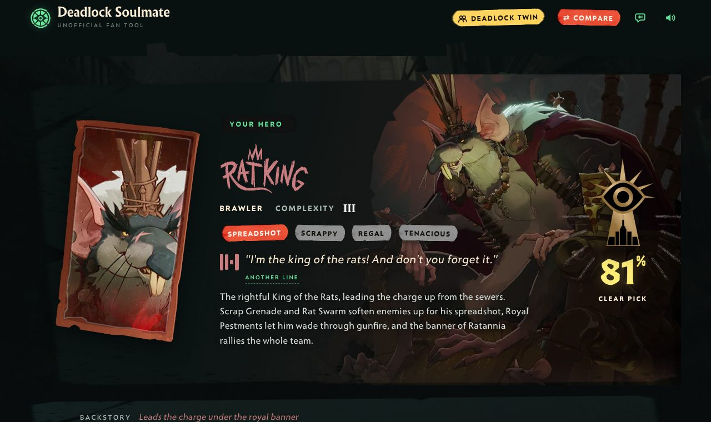
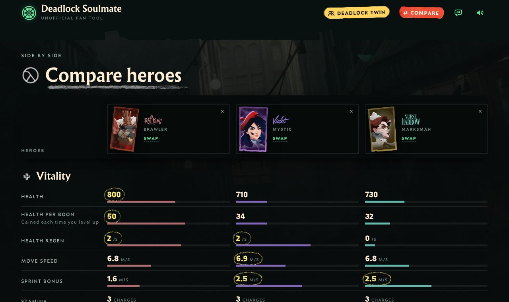

# Deadlock Soulmate

An unofficial fan site that matches you to a hero in Valve's [Deadlock](https://store.steampowered.com/app/1422450/Deadlock/). Answer a short playstyle quiz and a tarot-style reading picks your hero.

**Try it:** https://deadlock-soulmate.vercel.app/



## What's on the site

- **The reading.** 24 questions in six sections cover aim, range, mobility, team role, power curve and style. Each answer is scored against every hero across 23 playstyle traits. The result shows your top hero with the reasons and trade-offs behind the match, plus your runners-up.
- **Playing with friends.** Add up to three heroes your friends play. Heroes that team well with theirs move up your ranking, and heroes they already play drop out of it.
- **Sharing.** Every reading gets a share link, a short code a friend can paste in, and a downloadable result card.
- **Hero dossiers.** All 44 heroes have a page with their abilities (including upgrade tiers and cooldowns), base stats, voice lines, backstory, team fits and counters.
- **Compare.** See up to three heroes side by side: health, movement, weapon numbers and abilities, with the best value in each row circled.
- **Deadlock twin.** Pick a hero you play in Overwatch, Marvel Rivals, Valorant, League of Legends or Apex Legends, and see which Deadlock heroes play the same way.





## Status and limitations

- **Personal fan project, updated by hand.** The data is a snapshot of game build 6805 (October 2026) and covers all 44 playable heroes, including Rat King, Baba, Solomon, Deadman Danny, Violet and Nurse Harrow. Balance patches after that build aren't reflected until the data is regenerated.
- **Some content is judgement, not game data.** Stats, abilities and descriptions come from the game files. The quiz trait scores, hero pitches, team fits and cross-game twins are hand-written opinions.
- **Cross-game rosters are dated.** Each game's roster is as of the date recorded in its `xg/<game>/data.json` (for example, Overwatch Season 5 and League of Legends patch 26.19).
- **English only.** Works on desktop and mobile browsers. Quiz progress, friends' heroes and the sound settings are saved in your browser's local storage. There are no accounts.

## How it's built

There is no framework and no build step on the server. `pipeline/build2.py` assembles everything into a single self-contained `site/index.html` (markup, CSS, JavaScript and hero data inlined). Vercel serves the `site/` folder as static files, and `site/vercel.json` only redirects the site's old address.

| Path | Contents |
| --- | --- |
| `site/` | The deployed site: `index.html`, `img/` (cards, renders, ability icons, name marks, voice-line audio, fonts, UI art), `og.jpg` and `favicon.png`. |
| `src/` | Page sources. `template2.html` holds the markup and CSS, `app2.js` the app, and `model.js` the questions and scoring. `edit.js` has the hand-written pitches, ability one-liners and trait scores, and `team.js` the team fits and counters. `extra.js` is generated data. The folder also holds the quiz tests. |
| `pipeline/` | Python scripts that turn game files into data and build the page. |
| `xg/` | Cross-game rosters and portraits (`xg/<game>/data.json`), weapon stats, overview text and voice-line metadata. |
| `*.json` (root) | Generated hero data: base stats, ability stats and texts, kits. The `*_6701.json` files are the previous build's data, which `update_base.py` reads. |

## Development

You need Python 3 (3.13 tested; the page build uses only the standard library) and Node.js (22 tested) for the tests.

```bash
# Rebuild site/index.html after editing anything in src/ or the data files
python3 pipeline/build2.py

# Preview locally at http://localhost:8000
python3 -m http.server 8000 --directory site

# Check the quiz still works for every hero (takes a few seconds)
node src/test.js reach
```

`test.js reach` searches for the answers that favour each hero most. Every hero should show `1` in the third column, which means some set of answers makes them the top match. `node src/test2.js` prints how often each hero comes first for thousands of simulated players.

`build2.py` also writes `artifact/index.html` (git-ignored), the same page without its `<html>` and `<head>` wrapper.

**Deploying:** every push to `main` deploys to Vercel automatically, with `site/` as the project's root directory.

### Updating hero data after a game patch

> [!WARNING]
> The data scripts were written for the October 2026 update and are not yet a one-command pipeline. On a fresh clone, `gen_abil_text.py`, `new_vo.py` and `update_base.py` stop with missing-file errors (see the notes after the table).

Run the scripts from the repository root, with [GameTracking-Deadlock](https://github.com/SteamTracking/GameTracking-Deadlock) cloned into `gt/` (git-ignored):

| Order | Script | Reads | Writes |
| --- | --- | --- | --- |
| 1 | `parse_heroes.py` | `gt/…/heroes.vdata` | `heroes_raw.json` |
| 2 | `build_kits.py` | localization, `heroes_raw.json` | `kits.json` |
| 3 | `update_base.py` | `*_6701.json`, `kits.json`, `ext/api/heroes.json`, `ext/ab/*.png` | `hero_base.json`, `codes.json`, `site/img/ab/` |
| 4 | `abil_stats.py` | `gt/…/abilities.vdata`, localization | `abil_stats.json` |
| 5 | `gen_abil_text.py` | localization, `abil_vdata.pkl` | `abil_text.json` |
| 6 | `wpn3.py` | `heroes.vdata`, `heroes_raw.json`, `codes.json` | `xg/hstats.json` |
| 7 | `data3.py` | everything above, `xg/` | `src/extra.js`, `site/img/xg/*.webp` |
| 8 | `build2.py` | `src/`, `hero_base.json` | `site/index.html` |

Known gaps:

- `update_base.py` needs the [deadlock-api.com](https://deadlock-api.com) hero list and ability icons saved by hand into `ext/` (git-ignored), and it hard-codes the six October 2026 heroes.
- `gen_abil_text.py` reads `abil_vdata.pkl`, a pickled copy of the parsed `abilities.vdata` that no script writes yet.
- `new_vo.py` (voice-line audio sprites) opens `audio6.py` relative to the working directory, so it fails from both the root and `pipeline/`. It also needs `ffmpeg`.
- Hero cards, renders and name marks in `site/img/` were downloaded and converted by hand.

## Credits

- **Game data:** [SteamTracking/GameTracking-Deadlock](https://github.com/SteamTracking/GameTracking-Deadlock) (`heroes.vdata`, `abilities.vdata`, localization).
- **Hero cards, renders, ability icons and colours:** the [deadlock-api.com](https://deadlock-api.com) assets API.
- **Voice lines, innates and release dates:** the [Deadlock Wiki](https://deadlock.wiki).
- **Fonts, UI art and sounds:** Deadlock, © Valve.
- **Cross-game portraits:** [overwatch-hero-icons](https://github.com/drippinghere/overwatch-hero-icons), [rivals-player-assets](https://github.com/yuqichin/rivals-player-assets), [valorant-agent-picker](https://github.com/andrerfcsantos/valorant-agent-picker), [LoL_DDragon](https://github.com/InFinity54/LoL_DDragon) and [GameTeamer](https://github.com/HyIsNoob/GameTeamer) (Apex Legends).

<!-- TODO: confirm you want issue reports, and whether you accept pull requests -->
Spotted wrong hero data or a missing hero? [Open an issue](https://github.com/Versuessen/deadlock-hero-finder/issues).

## Legal

This is an unofficial fan project, not affiliated with or endorsed by Valve. Deadlock and its assets are © Valve Corporation. Characters from other games are © their respective owners.

<!-- TODO: add a LICENSE for the code, or state that all rights are reserved -->
